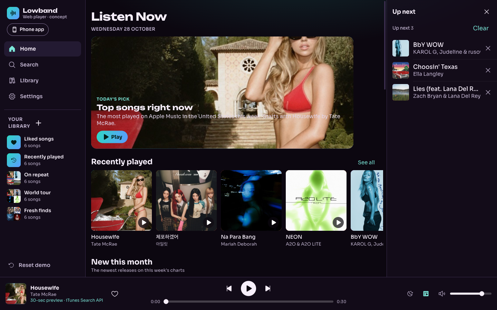
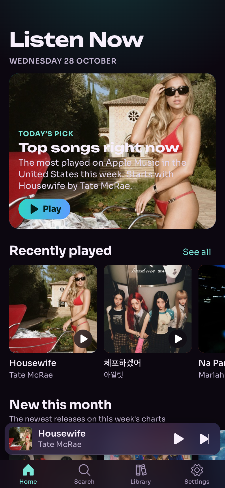
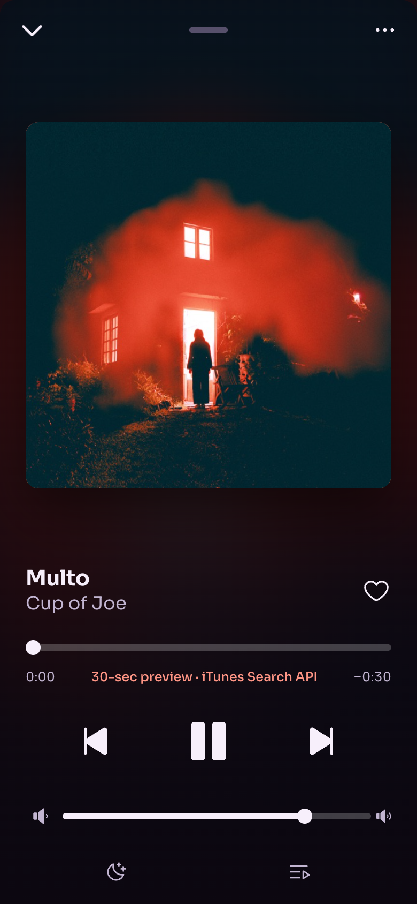
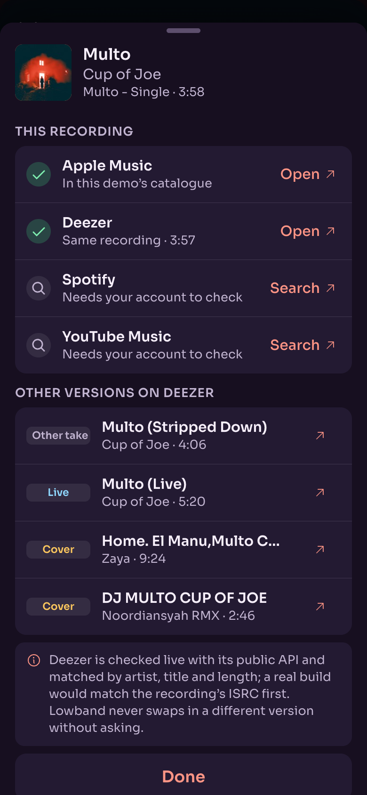

# Developing Lowband

For the product introduction, see [README.md](README.md).


**Live demo:** https://vanomarb.github.io/lowband/ is the landing page; https://vanomarb.github.io/lowband/play/ shows the phone app on phones and the web player everywhere else; https://vanomarb.github.io/lowband/app/ opens the phone app on any screen.

One library for music that lives on different services.

Lowband is a concept for a music library that sits above Spotify, YouTube Music and Apple Music: search once, see which service has which version of a song, keep playlists that survive when tracks go grey, and hand playback to the service that has it. Why it's shaped this way (catalogue gaps, greyed-out tracks, and platform terms that forbid one player streaming every service) is in [docs/lowband-use-cases.md](docs/lowband-use-cases.md).

This demo is a phone app and a desktop web player. It searches and plays 30-second previews from the public [iTunes Search API](https://performance-partners.apple.com/search-api) as a stand-in for the connected services. Connecting Spotify, YouTube Music or Apple Music is shown as a labelled concept, and no account is ever connected.

## Screenshots



| Listen Now | Full player | Where it plays |
| :---: | :---: | :---: |
|  |  |  |

Captured from the live demo. Album artwork belongs to its owners.

## What it ships with

- **Landing page** at `/`: `Landing.tsx` and `landing.css`, the product page with links into the player. Its screenshots live in `public/shots/`.
- **Web player** at `/play`: `web/WebPlayer.tsx`, a desktop app with a library rail, a persistent player bar and an Up next panel. On phones, the same address shows the phone app instead.
- **Phone app** on phones at `/play`, and on any screen at `/app`: `Demo.tsx`, built to feel like a native mobile app, with a fixed nav bar and large titles, a translucent tab bar, sheets, an iOS-like type scale and safe areas.

Both use the same data, reducer, screens and audio engine (`hooks/useLowband.ts`). `phone.ts` is a small script that runs before the first paint: it detects a phone (a touch screen narrower than 600px, measured from the screen and the zoomed visible width so "Desktop site" mode can't hide it), so `app/play/page.tsx` can choose the layout, and in "Desktop site" mode it zooms the phone app back to the phone's real width.

## What you can try

- Real audio: every song plays its 30-second preview, labelled as a preview wherever the source is shown
- Search with a Songs / Albums / Artists switch, live against the iTunes Search API, with loading, empty and error states (songs fall back to the saved snapshot offline)
- Where it plays, from any song's ⋯ menu: Apple Music (this catalogue), Deezer checked live through its public API with the same recording separated from covers, remixes, sped-up edits and live takes, and search hand-offs to Spotify and YouTube Music, which can't be checked without an account
- Album pages with the tracklist in disc order, and artist pages with top songs and albums; reach them from search, the track menu ("Go to album", "Go to artist") or the artist name in the full player
- Liked songs, recently played, and playlists you can create, rename, delete and edit, with undo
- Mini-player that opens a full player with Up next, volume and a sleep timer that fades out
- Phone gestures: drag the full player or any sheet down to close it, and the system back gesture steps back through screens, the player and sheets instead of leaving the app
- Settings with Connected services as concept toggles: nothing is signed in

State lives in memory and resets when you reload.

## Data: what is real

- **Catalogue**: `data/itunes.ts` calls `search` (songs, albums, artists) and `lookup` (an artist's songs and albums, an album's tracklist). No key, CORS-enabled. Snapshot tracks have no iTunes ids, so their artist and album pages search by name and keep exact matches.
- **This week's music**: `data/tracks.ts` is generated by `scripts/refresh-catalog.mjs` from Apple Music's most-played charts in 12 countries, with each song looked up in the iTunes Search API for its preview, artwork and length (clean songs only). It drives Home's shelves (top songs, new releases, the #1 in each country, the Philippines and South Korea), the starting library and the date shown on Home. The deploy workflow regenerates it before every build and every Monday, so the demo keeps up with the charts without a server; if Apple is unreachable, the committed copy is used.
- **Engine**: `hooks/useAudioEngine.ts` owns one `HTMLAudioElement` and treats it as the source of truth: `timeupdate` drives position, `loadedmetadata` the duration, `waiting`/`playing` buffering, `ended` advances Up next, `error` stops with a toast. A blocked autoplay shows a toast. Media Session metadata and actions are set. The element is exposed as `window.__lowbandAudio` for inspection.
- **Where it plays**: `data/deezer.ts` searches the public Deezer API (no key; JSONP, because Deezer sends no CORS header) and sorts results by artist, title and length within three seconds. Version kinds are a keyword heuristic, labelled as such; a real build would match the ISRC first.

## What is not real

- **Connected services**: Spotify, YouTube Music and Apple Music appear as text-only concept toggles. Nothing signs in.
- **Full-length playback**: the iTunes Search API only serves 30-second previews, and Lowband never implies otherwise.

## Getting started

Requires Node.js 20.9 or later.

```bash
npm install
npm run dev      # http://localhost:3111/lowband/
```

Open [http://localhost:3111/lowband/](http://localhost:3111/lowband/) for the landing page, [http://localhost:3111/lowband/play/](http://localhost:3111/lowband/play/) for the web player and [http://localhost:3111/lowband/app/](http://localhost:3111/lowband/app/) for the phone app. Every route sits under `/lowband` because the site is deployed as a GitHub Pages project page (see Deployment).

Other scripts:

```bash
npm run build      # static export to out/
npm run lint       # ESLint
npm run typecheck  # TypeScript, no emit
```


No API keys or environment variables are needed: the iTunes Search API and the Deezer API are both public.

## Deployment

The app is a static export (`output: 'export'` with `basePath: '/lowband'` in `next.config.mjs`). Every push to `main` runs `.github/workflows/deploy.yml`, which builds `out/` and deploys it to GitHub Pages at `https://[YOUR_NAME].github.io/lowband/`. 
To preview a build locally, serve `out/` from a folder named `lowband` so the paths match.

## Structure

```text
lowband/
  app/           Next.js routes: / (landing), /play (web player, or the phone app on phones) and /app (phone app)
  Demo.tsx       the phone app
  Landing.tsx    the landing page (styles in landing.css, screenshots in public/shots/)
  meta.ts        product copy: summary, use cases, key decisions; also feeds the page title
  types.ts       shared prop and metadata types
  data/          types, the iTunes and Deezer clients, this week's chart snapshot and shelves (generated), and search categories
  state/         reducer split into playback.ts and library.ts; seed.ts is the first state
  hooks/         useLowband (shared core), useAudioEngine, useSearch, useLookup, useSwipe
  screens/       Home, Search, Library, Settings, Collection, Album, Artist, Router
  components/    Page (nav bar + scroll region), Art, TrackRow, Music (album/artist rows), players, sheets
  web/           WebPlayer, Rail, PlayerBar
  docs/          research behind the use cases
  scripts/       next-dev.mjs
  theme.css native.css player.css screens.css web.css landing.css
```

## References

Patterns, data sources and what was deliberately not copied are listed in [REFERENCES.md](REFERENCES.md). No service logo or brand asset appears in the app.

## Disclaimer

Lowband provides preview playback, not a connected streaming service. Spotify, YouTube Music, Apple Music and Deezer are trademarks of their respective owners. Lowband is not affiliated with any of them.
